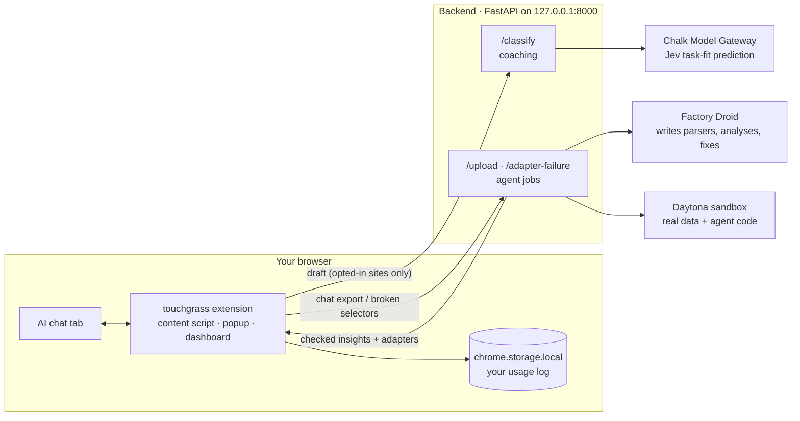

<p align="center">
  
</p>

<h1 align="center">touchgrass</h1>

<p align="center"><b>Everyone here used AI today. Nobody knows what it cost.</b><br/>
touchgrass shows the energy, water and CO₂ behind every prompt you send, and nudges you to a lighter model when a big one is overkill.</p>

---

## What it does

1. **Tracks.** A Chrome extension watches the AI sites you opt into (ChatGPT, Claude, Gemini, Perplexity, Grok and more). It logs every prompt locally and turns it into Wh, mL and gCO₂e from published per-prompt figures.
2. **Coaches.** While you type, a Chalk-hosted classifier decides whether your draft needs a frontier model. If not, our mascot Musky offers three choices: **switch to the light model here**, **open it in a greener AI**, or **send anyway**. It never blocks a send.
3. **Learns and repairs itself.** Upload your chat export and Factory Droid writes a parser for it plus a personal waste analysis, inside Daytona sandboxes, so your history never touches our server's disk. When a site changes its HTML and the extension's selectors break, Droid writes the fix and the extension hot-loads it. **Our own validators, not the agent, decide what ships.**

## How it fits together



| Layer | In one line | Deep dive |
| --- | --- | --- |
| **Frontend:** Chrome MV3 extension (`extension/`) | WXT + React 19. Content script with capture-phase listeners, a Chalk-first verdict with a local fallback, a shadow-DOM toast, a local footprint ledger, and versioned self-healing selectors | **[Extension architecture](docs/extension-architecture.md)** |
| **Backend:** FastAPI (`backend/`) | Real-time `/classify` within a ~700 ms budget, plus background Droid jobs behind an executor that runs in Daytona, local or replay mode | **[Backend architecture](docs/backend-architecture.md)** |

## Where each technology does real work

| Tech | What it does in touchgrass | Code | Details |
| --- | --- | --- | --- |
| **Chalk** (Model Gateway + Jev) | Live per-draft decision: one prediction, suggest only above a 0.71 `small_ok` probability. Offline `chalkcompute` evaluations of the classifier | [`backend/coaching/`](backend/coaching/), [`evals/`](evals/) | [Where Chalk works](docs/where-chalk-works.md) · [General coach](docs/general-coach.md) |
| **Factory Droid** | Runs *inside the product* as three jobs: **Ingestor** (parser for an unknown export format), **Analyst** (your top 3 waste patterns), **Mechanic** (repairs broken site selectors). Autonomy `OFF`, path-restricted permission handler | [`sandbox_jobs/droid_runner.py`](sandbox_jobs/droid_runner.py) | [Where Droid works](docs/where-droid-works.md) |
| **Daytona** | One ephemeral sandbox per upload or repair. It holds the real export and runs the code Droid wrote. Only checked results come out, and no keys go in | [`backend/sandbox.py`](backend/sandbox.py) | [Where Daytona works](docs/where-daytona-works.md) |
| **NASA GIBS** | VIIRS night-lights growth over data-center regions: Northern Virginia **+38.8%** (2012 → 2026, June–August) | [`space/`](space/) | [Seen from space](docs/seen-from-space.md) |
| **Groq** | Recognises AI sites that aren't in our list (`llama-3.1-8b-instant`) | [`extension/lib/groqClassify.ts`](extension/lib/groqClassify.ts) | [Extension architecture](docs/extension-architecture.md#permissions-nothing-runs-until-the-user-opts-in) |

## Run it

**Backend** (Python 3.12+, from the repo root):

```sh
cp .env.example .env        # fill in FACTORY_API_KEY, DAYTONA_API_KEY, CHALK_* (see the comments in the file)
uv sync
uv pip install droid-sdk jsonschema beautifulsoup4 pandas python-multipart   # Droid job dependencies
uv run python start.py      # Daytona mode if DAYTONA_API_KEY is set, else local; API docs at :8000/docs
uv run python start.py --replay   # no network needed: replays saved Droid runs
```

Live Droid jobs also need the `droid` CLI on PATH (`curl -fsSL https://app.factory.ai/cli | sh`, or `irm https://app.factory.ai/cli/windows | iex` on Windows).

To turn on the cross-provider coach, add `COACHING_GENERAL_CONFIG_PATH=config/coaching/general-coach.json` to `.env`.

**Extension:**

```sh
cd extension
npm install
npm run build               # then chrome://extensions → Developer mode → Load unpacked → extension/.output/chrome-mv3
```

Click the toolbar icon, meet Musky, pick your AI sites, and type a quick question on ChatGPT, such as "what is the capital of france". The extension pairs with the backend by itself.

**Try the coach without the extension:**

```sh
TOKEN=$(curl -s -X POST localhost:8000/coaching/auto-pair | jq -r .session_token)
curl -s localhost:8000/classify -H "Authorization: Bearer $TOKEN" -H "Content-Type: application/json" -d '{
  "request_id":"00000000-0000-4000-8000-000000000001","draft_revision":1,"conversation_id":"c1",
  "site":"chatgpt","current_model_label":"GPT-5","prompt_text":"what is the capital of france",
  "opted_in":true,"target_available":true}' | jq '{action, reason_code, target, message}'
# → "suggest_small", target GPT-4o mini. A 3,000-word analysis request → "keep_current", "needs_big".
```

## Test it

```sh
cd extension && npx vitest run     # 177 unit tests: coach rules, arbiter, adapters, footprint, score, ...
cd extension && npx playwright test   # built extension in Chromium on fixture pages
uv run pytest tests                # 106 backend tests: classify API, policy, Chalk contracts, evals
uv run python smoke_test.py        # both Droid flows end to end with saved outputs, ~30 s, 0 credits
uv run python smoke_test.py --live # real Droid calls (~65k–100k Factory credits)
uv run pytest sandbox_jobs/test_privacy.py   # planted-marker privacy test
```

## Repo map

```text
extension/      Chrome extension: entrypoints/ (content, background, popup, dashboard), lib/ (coach, footprint, adapters), components/
backend/        FastAPI app: coaching/ (classify, policy, Chalk client), executor.py + sandbox.py (jobs), adapters/, demo_runs/
sandbox_jobs/   Droid job code (ingest, analyze, repair_adapter, droid_runner) and lib/: our validators, never written by Droid
config/         Coaching profiles, policies, and the general-coach provider map
evals/          Chalk evaluation datasets, runners, scorers, threshold tuning
space/          NASA GIBS night-lights insight
docs/           Architecture deep dives, runbooks, API schemas
start.py        Backend launcher (daytona / local / --replay)
smoke_test.py   End-to-end upload + repair test
```

`web/` and `backend/voice.py` are placeholders that weren't built in time.

## Honest limits

- **Footprint numbers are estimates**, not metering. Every figure in [`footprint.ts`](extension/lib/footprint.ts) names its source, and the assumptions (small model = 25% of big, image = 10 prompts) are labelled as such. The backend Analyst's `footprint.py` still uses marked placeholder ranges.
- **The 0.71 coach threshold comes from one model pair** (15 held-out suggestions, 0 harmful among the 14 graded). It's applied provisionally to all providers and labelled that way in the UI.
- **Droid runs on the backend, not in Daytona** (our tier blocks Factory's domains). It only sees redacted or fake data. A stray file read can be detected by our privacy test, not prevented.
- Every Droid run so far used **fake or planted exports**, not a real user's history.

## Read more

**Architecture:** [Extension](docs/extension-architecture.md) · [Backend](docs/backend-architecture.md) · [Droid](docs/where-droid-works.md) · [Daytona](docs/where-daytona-works.md) · [Chalk](docs/where-chalk-works.md) · [General coach](docs/general-coach.md) · [Seen from space](docs/seen-from-space.md)

**Run and wire:** [Coaching integration](docs/coaching-integration.md) · [Chalk setup](docs/chalk-setup.md) · [Chalk runbook](docs/chalk-runbook.md) · [Chalk CLI](docs/chalk-cli-reference.md) · [Try it with Droid](docs/try-it-with-droid.md)

**Schemas:** [OpenAPI](docs/coaching-openapi.json) · [Normalized exchange](docs/normalized-exchange.schema.json) · [Ingest attempt](docs/ingest-attempt.schema.json)
