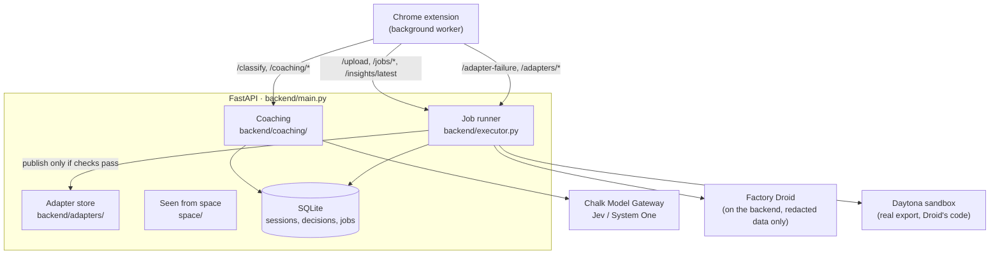
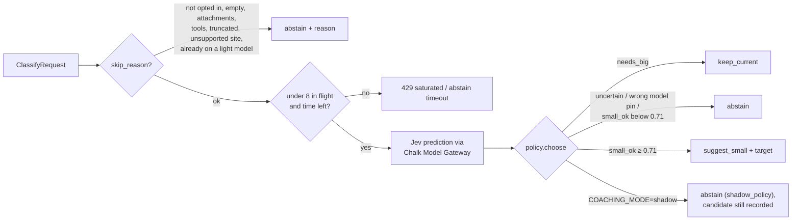
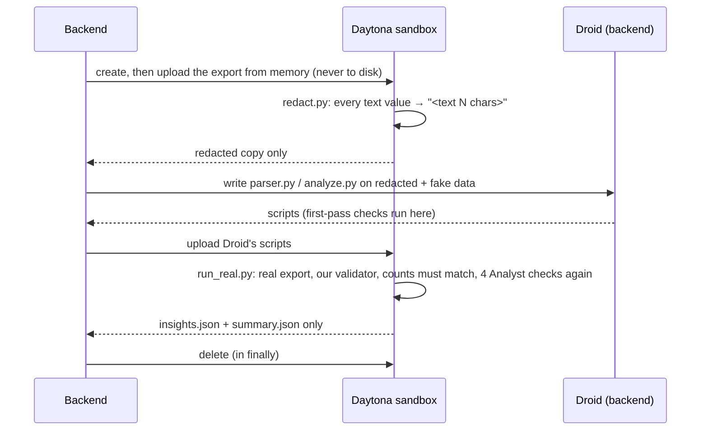

# Backend architecture

One FastAPI app ([`backend/main.py`](../backend/main.py)) on `127.0.0.1:8000` does two jobs:

1. **Coaching, in real time.** Is this draft simple enough for a lighter model? One Chalk Jev prediction, with a ~700 ms budget.
2. **Agent jobs, in the background.** Factory Droid writes a parser for your chat export, writes your personal waste analysis, and repairs the extension's selectors when a site changes. Private data and agent-written code are kept in Daytona sandboxes. **Our own validators, not Droid, decide what ships.**

Back to the [root README](../README.md). Frontend side: [Extension architecture](extension-architecture.md).

## Routes

| Route | What it does | Code |
| --- | --- | --- |
| `GET /health` | Mode (`daytona` / `local` / `replay`) and why | `main.py` |
| `POST /coaching/auto-pair`, `POST /coaching/pair` | Mint a bearer session. Only its SHA-256 is stored | [`coaching/router.py`](../backend/coaching/router.py), [`repository.py`](../backend/coaching/repository.py) |
| `POST /classify` | Draft → `suggest_small` / `keep_current` / `abstain` + reason | [`coaching/service.py`](../backend/coaching/service.py) |
| `GET /coaching/targets` | The lighter model for each site, with the labels its model menu uses | `coaching/router.py`, [`general.py`](../backend/coaching/general.py) |
| `POST /coaching/events` | What the user did with a suggestion (`shown`, `switch_clicked`, `sent_anyway`, `dismissed`) | `coaching/router.py` |
| `GET /coaching/insights`, `GET /evals/summary` | Aggregate coach history and eval summary for the popup and dashboard (no prompt text) | `coaching/router.py`, [`reports/router.py`](../backend/reports/router.py) |
| `POST /upload` | Chat export → job id at once; Ingestor then Analyst run in the background | `main.py`, [`executor.py`](../backend/executor.py) |
| `GET /jobs/{id}`, `/jobs/{id}/logs`, `/jobs/{id}/audit` | Status; live Droid log as Server-Sent Events; every file in and out of the sandbox | `main.py`, [`jobs.py`](../backend/jobs.py) |
| `GET /insights/latest` | The latest checked `insights.json` | `main.py` |
| `POST /adapter-failure` | Broken-selector report → Mechanic repair. Stale or duplicate reports are folded into the running job | `main.py` |
| `GET /adapters/versions`, `GET/PUT /adapters/{site}` | Published selector JSON the extension hot-loads | `main.py`, [`backend/adapters/`](../backend/adapters/) |
| `GET /space/insight` | NASA night-lights growth over data-center regions, plus your share | [`space/nasa_lights.py`](../space/nasa_lights.py) |

Full contract with example payloads: `http://127.0.0.1:8000/docs` while the server runs, or [`docs/coaching-openapi.json`](coaching-openapi.json).

## 1. Coaching: `/classify` in detail

- **Request → skip check** ([`service.py`](../backend/coaching/service.py) `skip_reason`): the cheap no-cost exits come first. It doesn't coach drafts with attachments, tool use, truncated context or non-text modality, and it doesn't coach sites the user didn't opt into.
- **One prediction, hard deadline:** `CLASSIFY_DEADLINE_MS` (default 700 ms, minus a reserve for saving the decision). `CLASSIFY_MAX_CONCURRENCY` (default 8) caps calls in flight, and a full server answers `429` instead of queueing. A timeout becomes `abstain: timeout`. The extension then waits at most 1.5 s in total before using its local rule.
- **Policy** ([`policy.py`](../backend/coaching/policy.py) `choose`): suggest only when Jev says `small_ok` with probability ≥ the threshold, and only when the resolved Jev model matches the pinned one. A policy built for one profile can't be used with another (`policy_mismatch`).
- **General coach** ([`general.py`](../backend/coaching/general.py), [`config/coaching/general-coach.json`](../config/coaching/general-coach.json)): one task-fit question for every provider, mapped to each site's lighter model (GPT-4o mini, Haiku 4.5, Gemini Flash, Sonar, Grok mini). The threshold of **0.71** is provisional: it was carried over from the Haiku/Sonnet experiment, with 15 held-out suggestions, 14 graded, 0 harmful. Responses say `recommendation_scope: generalized`, and the extension labels them provisional. Turned on by `COACHING_GENERAL_CONFIG_PATH`. Without it, the original single-pair coach runs. Details: [General coach](general-coach.md).
- **What's stored** ([`repository.py`](../backend/coaching/repository.py)): an HMAC-SHA256 digest of the request, the decision, and later events, all in SQLite. **The raw prompt is not stored.**
- **Keys:** `CHALK_ROUTER_API_KEY` stays in the backend's `.env`. The browser only ever holds its session token.
- **Offline evaluation** ([`evals/`](../evals/)): datasets, the local and Chalk `chalkcompute` runners, scorers and threshold tuning. See [Where Chalk works](where-chalk-works.md) and the [Chalk runbook](chalk-runbook.md).

## 2. Agent jobs: Droid writes, our checks decide

All three jobs go through one function, [`run_droid_job`](../sandbox_jobs/droid_runner.py). It opens a Droid SDK session at autonomy `OFF`, so **every file write and command reaches our permission handler**. Writes are allowed only inside the job's own folder, and only Python on files in it.

| Job | Trigger | Droid writes | We verify with | Then |
| --- | --- | --- | --- | --- |
| **Ingestor** | `POST /upload`, with an export format we haven't seen (known formats reuse the cached parser: 0 credits, under a second) | `parser.py` from a **redacted** copy | [`validate_prompts.py`](../sandbox_jobs/lib/validate_prompts.py) against [`schema.json`](../sandbox_jobs/lib/schema.json), on the redacted copy and then on the real export, where the counts must match | Parser cached by structure fingerprint |
| **Analyst** | Every upload | `analyze.py` from fake prompts + counts of the real data | Four checks: `footprint.py` unchanged (SHA-256), schema valid, re-run identical, no hard-coded footprint numbers | `insights.json`: totals + your 3 biggest waste patterns |
| **Mechanic** | `POST /adapter-failure` | The next adapter version from a **cleaned** page | [`check_adapter.py`](../sandbox_jobs/lib/check_adapter.py) on the page, same keys, version exactly +1 | Published to `backend/adapters/`; the extension picks it up |

Measured live (Daytona mode, `py smoke_test.py --live`): Ingestor 169 s, Analyst 176 s, Mechanic 65 s, **65,302 Factory credits** in total, 13/13 checks passed. More, including guardrails and known SDK issues: [Where Droid works](where-droid-works.md).

## 3. Daytona: the hybrid privacy boundary

Our Daytona tier blocks Factory's domains from inside a sandbox, so Droid can't run in one. We split the work instead ([`backend/sandbox.py`](../backend/sandbox.py)):

- The export and the parsed `prompts.jsonl` **never leave the sandbox**. `GET /jobs/{id}/audit` lists every file that went in or out, by name and size.
- No API keys go into the sandbox. Sandboxes are ephemeral, labelled, auto-stopping and time-limited, and [`cleanup_sandboxes.py`](../backend/cleanup_sandboxes.py) removes leftovers. We tested this by killing the backend in the middle of a job.
- Repairs work the same way: the raw page is cleaned in a short-lived sandbox (it fails closed if an email or conversation link survives), and Droid sees only the cleaned page.
- [`test_privacy.py`](../sandbox_jobs/test_privacy.py) plants marker words in a sample export and fails if any of them reaches Droid's logs, transcripts or folders, or the backend's disk outside the returned insights. The latest live run passed 8 of 8.

Measurements and limits: [Where Daytona works](where-daytona-works.md).

## Modes

| Mode | When | What runs |
| --- | --- | --- |
| **Daytona** | `DAYTONA_API_KEY` set (default for the demo) | The hybrid flow above, up to 3 uploads at once |
| **Local** | No Daytona key, or `--local` | The same jobs in `work/jobs/<id>/` on this machine; exports deleted afterwards |
| **Replay** | `--replay` / `DEMO_REPLAY=1` | Saved successful runs from [`backend/demo_runs/`](../backend/demo_runs/), streamed at their original pace, for bad Wi-Fi |

Coaching has its own switches: `PROMPTPRINT_MODE=mock|live` and `COACHING_MODE=shadow|suggest`.

## Honest limits

- Droid runs on the backend, not in the sandbox. It sees only redacted or fake data, but file *reads* don't go through our permission handler. So a stray read can be detected by the privacy test, not prevented.
- The redacted copy shows the export's structure, text lengths, timestamps and one-word fields such as model names.
- `backend/footprint.py`, used by the Analyst, still has clearly marked placeholder ranges. The extension's own footprint numbers ([`extension/lib/footprint.ts`](../extension/lib/footprint.ts)) are sourced estimates.
- The 0.71 general-coach threshold wasn't calibrated per provider. It's labelled provisional everywhere it shows.
- There's no auth beyond the session token. The API is meant to run on loopback for a single-machine demo.
