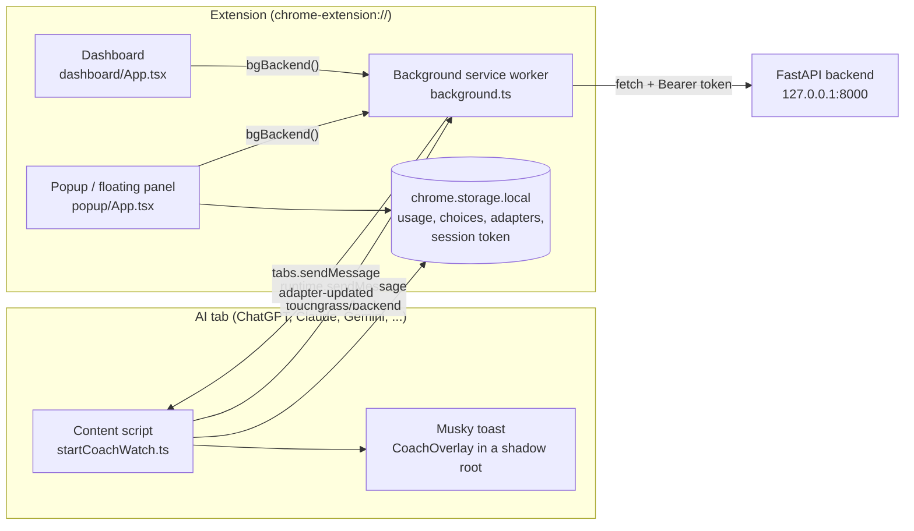
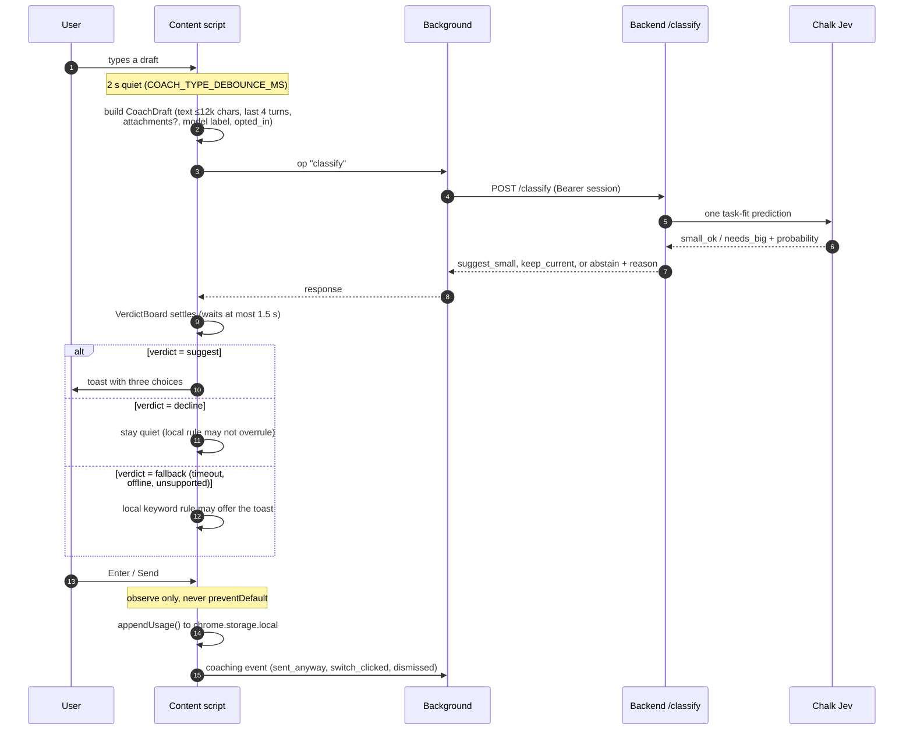
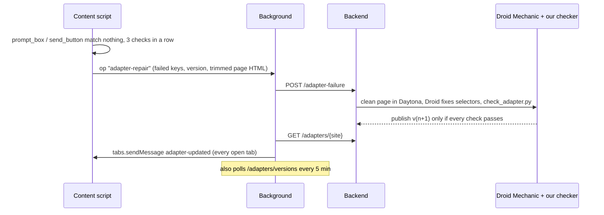

# Extension architecture

The Chrome extension (`extension/`) is what the user meets. It watches the AI chat tabs the user opted into, logs every prompt they send, estimates the energy, water and CO₂ behind it, and, when a simple ask is about to go to a big model, offers a lighter option. **It never blocks or delays a send.**

Built with [WXT](https://wxt.dev) (Manifest V3), React 19 and Tailwind. Back to the [root README](../README.md). Backend side: [Backend architecture](backend-architecture.md).

## The pieces



**Only the background worker talks to the network.** Content scripts, the popup and the dashboard send it a message (`bgBackend(op, …)` in [`lib/backendBridge.ts`](../extension/lib/backendBridge.ts)), and it calls the API with [`lib/backendClient.ts`](../extension/lib/backendClient.ts). The page's own JavaScript never sees the session token or any API key.

| Entrypoint | File | Role |
| --- | --- | --- |
| Content script | [`entrypoints/content.ts`](../extension/entrypoints/content.ts) → [`lib/startCoachWatch.ts`](../extension/lib/startCoachWatch.ts) | Runs on every opted-in AI site. Records sends, asks the backend for a verdict, shows the toast, reports broken selectors |
| Background | [`entrypoints/background.ts`](../extension/entrypoints/background.ts) | Message bus and only network client. Auto-pairs a coaching session, syncs adapters every 5 minutes, opens the floating panel, runs the upload and repair pipelines |
| Popup / floating panel | [`entrypoints/popup/App.tsx`](../extension/entrypoints/popup/App.tsx), [`lib/floatingPanel.ts`](../extension/lib/floatingPanel.ts) | Score, streak, Day/Week/Month footprint, CO₂ saved, coach tips. The toolbar click injects a rounded, draggable panel that frames `popup.html`; Chrome-protected pages fall back to the normal popup |
| Onboarding | [`components/InlineOnboarding.tsx`](../extension/components/InlineOnboarding.tsx) (inside the popup) | Musky intro, name, and which AI sites to watch. Picking a site requests that host permission at that moment |
| Dashboard | [`entrypoints/dashboard/App.tsx`](../extension/entrypoints/dashboard/App.tsx) | Weekly recap (`Alt+Shift+P`), chat-export upload (runs the Droid pipeline), backend health, eval summary, shareable achievement card |
| Test pages | `entrypoints/fixture/`, `entrypoints/hop/` | Fake composers used by the Playwright tests |

## Permissions: nothing runs until the user opts in

[`wxt.config.ts`](../extension/wxt.config.ts) asks only for `storage`, `tabs`, `scripting`, `alarms` and `activeTab` at install. The only required hosts are the local backend (`127.0.0.1:8000`, `localhost:8000`) and Groq. **Every AI site is an optional host permission.** Onboarding calls `permissions.request` only for the sites the user ticks. The background then registers the content script for those hosts and injects it into tabs that are already open ([`lib/coachInject.ts`](../extension/lib/coachInject.ts) `rebindCoachScripts`).

Supported sites are data, not code: [`data/platforms.json`](../extension/data/platforms.json) lists each site's hosts, its big default model and its small model (ChatGPT `gpt-5` → `gpt-4o-mini`, Claude `claude-opus` → `claude-haiku`, Gemini `gemini-pro` → `gemini-flash`, Perplexity, Grok, plus image and video sites). For a host that isn't listed, [`lib/siteDetect.ts`](../extension/lib/siteDetect.ts) asks Groq (`llama-3.1-8b-instant`, through the background) whether it's an AI product. This is the only thing Groq is used for in the live flow.

## What happens when you type and send

All of this lives in [`lib/startCoachWatch.ts`](../extension/lib/startCoachWatch.ts). It uses capture-phase listeners on `document` (`input`, `keyup`, Enter `keydown`, send-button `click`), so it survives sites like Claude remounting their composer. It also uses a `MutationObserver` that notices conversation or model changes.



### 1. The draft and its identity

`buildDraft` turns the composer into a `CoachDraft`: a fresh `request_id`, a rising `draft_revision`, the conversation path, the site id, the model label read from the page's model picker, the text (capped at 12,000 characters), up to 4 recent turns ([`lib/coachYes.ts`](../extension/lib/coachYes.ts) `scrapeRecentMessages`), whether files are attached, and whether the user opted this site in.

**A response is only used if it answers this exact draft.** `requestChalk` throws away any response whose `request_id`, `draft_revision`, conversation, site or model label doesn't match. Any edit, send, navigation or model switch bumps `draftEpoch`, and every await checks it afterwards. A slow answer for an old draft can never show up on a new one.

### 2. Chalk decides first, the local rule is only a fallback

[`lib/coachArbiter.ts`](../extension/lib/coachArbiter.ts) turns the backend's response into one of three verdicts:

| Verdict | When | What the extension does |
| --- | --- | --- |
| `suggest` | `action = suggest_small` with a real target model and a live TTL | Shows the toast with Chalk's target, e.g. "This task may work well with GPT-4o mini" |
| `decline` | Chalk *measured* the draft and said no (`needs_big`, `below_threshold`, `uncertain`, `already_lightweight`, …) | Nothing. **A measured "no" can't be overruled by the keyword rule** |
| `fallback` | No response in 1.5 s, backend off, or a reason Chalk can't judge (unsupported site, attachments, …) | The local rule in [`lib/classify.ts`](../extension/lib/classify.ts) may offer the toast |

`VerdictBoard` holds exactly one pending verdict per draft. It resolves to `fallback` after 1.5 s, or as soon as the user edits or sends, so no listener is left waiting.

The local rule is deliberately simple. A text prompt is `small_ok` when it's short and has no code, math or "real work" hints, and the user is on the site's big default model ([`lib/coachChoice.ts`](../extension/lib/coachChoice.ts) `shouldOfferChoice`). Images and video are always `needs_big`.

### 3. The toast: three choices, and sending always works

The toast is a React component ([`components/CoachOverlay.tsx`](../extension/components/CoachOverlay.tsx)) mounted in a **shadow root** ([`lib/coachMount.ts`](../extension/lib/coachMount.ts)), so the site's CSS can't break it and it can't break the site.

| Button | What it does | Logged as |
| --- | --- | --- |
| **Switch to *model* here** | Opens the site's model menu and clicks the target (Chalk's label and aliases, or anything matching mini/Haiku/Flash/…). If it can't find the option, it leaves the menu open and says so. It never pretends | `switch_here` + `picked` / `menu_open` / `no_menu`; Chalk event `switch_clicked` |
| **Open in *other AI*** | The lowest-energy model among the user's *other* enabled sites ([`greenerAlternative`](../extension/lib/coachChoice.ts)). Opens it with the prompt prefilled in the URL (ChatGPT, Claude, Perplexity, Grok; ≤1,500 chars), or copies the prompt to the clipboard for sites without prefill | `open_other` + `prefilled` / `copied` |
| **Send anyway** | Clicks the site's real send button | `send_anyway`; Chalk event `sent_anyway` |

Pressing Enter with the toast up counts as "send anyway". The send itself goes through untouched: `onSend` only *observes* the keydown or click and never calls `preventDefault`. If no toast showed while typing, a short **after-send** toast may appear for the next prompt instead. Every 5th prompt in a row on a big model gets a **check-in** toast. A 60-second cooldown (`COACH_HIDE_MS`) stops toasts from piling up.

Chalk responses from the general coach (`recommendation_scope = generalized`) carry a **"General guidance · provisional"** badge and claim no Wh saving, because that threshold wasn't calibrated per provider. See [General coach](general-coach.md).

### 4. Logging the prompt

On every real send, `recordSend` appends a `UsageRow` (time, site, model, `text`/`image`/`video`, the first 2,000 characters, regenerated?, attachment count) to `chrome.storage.local` ([`lib/storage.ts`](../extension/lib/storage.ts), newest 2,000 rows kept). It reads the composer and counts attachments *synchronously*, before the site clears the box. Clicks on regenerate or retry buttons are logged as regenerations. Toast choices are logged separately (`appendCoachChoice`).

## Footprint, score and savings: all computed locally

The popup and dashboard compute everything from the local usage log. **No usage leaves the browser for these numbers.**

- **Per-prompt footprint** ([`lib/footprint.ts`](../extension/lib/footprint.ts)). Every value names its source:
  - ChatGPT uses OpenAI's published average (0.34 Wh, about 0.32 mL; Altman, June 2025).
  - Gemini uses Google's published median (0.24 Wh, 0.26 mL, 0.03 gCO₂e; August 2025).
  - Sites with no published figure (Claude, Grok, Perplexity, DeepSeek) use the midpoint of those two.
  - Clearly labelled **assumptions**: a small model costs 25% of its site's big one, an image ≈ 10 text prompts, a video ≈ 1,000.
- **Totals** for Day, Week and Month ([`lib/totals.ts`](../extension/lib/totals.ts), [`lib/weekTotals.ts`](../extension/lib/weekTotals.ts)). Until there's a full window of history, Week and Month are scaled up from the daily average and marked "(projected)" ([`lib/projection.ts`](../extension/lib/projection.ts)).
- **CO₂ saved** ([`lib/savings.ts`](../extension/lib/savings.ts)): the difference between what a prompt cost and what its site's big model would have cost.
- **Score** ([`lib/score.ts`](../extension/lib/score.ts)): starts at 100 a day and loses points for oversized asks (+15), regenerations (+5), images (+25) and video (+40). These are coaching weights we chose, not measurements. **Streak** ([`lib/streak.ts`](../extension/lib/streak.ts)) counts good days in a row.
- **Tips** come from two places: local cards from your own prompts ([`lib/usageInsights.ts`](../extension/lib/usageInsights.ts)), and the backend's `GET /coaching/insights` (aggregate coach history, no prompt text).

## Self-healing selectors (the Mechanic loop)

Sites change their HTML. The extension's selectors are **versioned JSON, never code** ([`lib/adapter.ts`](../extension/lib/adapter.ts); bundled copy in [`adapters/chatgpt.json`](../extension/adapters/chatgpt.json)):

```json
{ "site": "chatgpt", "version": 3,
  "selectors": { "prompt_box": "...", "send_button": "...", "model_name": "...", "response": "..." } }
```



`snapshotHtml` removes scripts and styles first, so the 200 KB cap keeps the composer and messages. The backend then cleans the page again inside a Daytona sandbox before Droid sees it ([Where Daytona works](where-daytona-works.md)). The adapter in use is the cached one if it exists, otherwise the bundled one. Without a working adapter, generic selectors still find the composer ([`lib/findComposer.ts`](../extension/lib/findComposer.ts)).

## Talking to the backend

`background.ts` handles one message type, `touchgrass/backend`, with an `op`:

| `op` | API call | Used by |
| --- | --- | --- |
| `classify` | `POST /classify` | Content script, every eligible draft |
| `coaching-event` | `POST /coaching/events` | Toast choices and sends |
| `coaching-targets` | `GET /coaching/targets` | Content script (cached 30 s): each site's lighter model and its menu aliases |
| `coaching-insights` | `GET /coaching/insights` | Popup tips |
| `pair` | `POST /coaching/pair` | Manual pairing code (optional) |
| `upload-pipeline` | `POST /upload` → poll `GET /jobs/{id}` → `GET /insights/latest` | Dashboard export upload (Droid Ingestor + Analyst) |
| `adapter-repair` / `adapter-sync` / `adapter-fetch` / `adapter-get` | `POST /adapter-failure`, `GET /adapters/versions`, `GET /adapters/{site}` | Mechanic loop above |
| `health`, `evals-summary` | `GET /health`, `GET /evals/summary` | Dashboard status |

**Session:** on startup the background calls `POST /coaching/auto-pair` and keeps the bearer token in `chrome.storage.local`. The backend stores only its SHA-256. If a call gets a 401, the client pairs again once and retries ([`backendFetch`](../extension/lib/backendClient.ts)). If the backend is off, every coach decision falls back to the local rule and logging keeps working.

## Privacy, in the extension

- Prompt text stays in `chrome.storage.local` on this machine (first 2,000 characters, newest 2,000 prompts). Nothing syncs it anywhere.
- Drafts go to the backend only for opted-in sites, for `/classify`. The backend keeps an HMAC digest and metadata, not the prompt ([Where Chalk works](where-chalk-works.md)).
- The coach's console audit logs only metadata (ids, reasons, timings), never draft text or tokens.
- The page never sees keys. The Chalk gateway key stays on the backend. The Groq key is a build-time value (`WXT_GROQ_API_KEY`), used only for unknown-host detection.
- When the extension is reloaded, old content scripts detect their dead `chrome.runtime` and shut themselves down instead of spamming errors (`isExtensionContextAlive`).

## Tests

```sh
cd extension
npm install
npx vitest run          # 18 files, 177 tests: coach choice, arbiter, draft lifecycle, adapters, footprint, score, upload parsing, ...
npx playwright test     # loads the built extension in Chromium on the fixture pages
```

The coach's decision rules are covered in [`tests/coachChoice.test.ts`](../extension/tests/coachChoice.test.ts) and [`tests/draftCoach.test.ts`](../extension/tests/draftCoach.test.ts). The extension-to-API contract is in [`tests/backendClient.test.ts`](../extension/tests/backendClient.test.ts). The last recorded run is in [`extension/TEST_RESULTS.md`](../extension/TEST_RESULTS.md).
